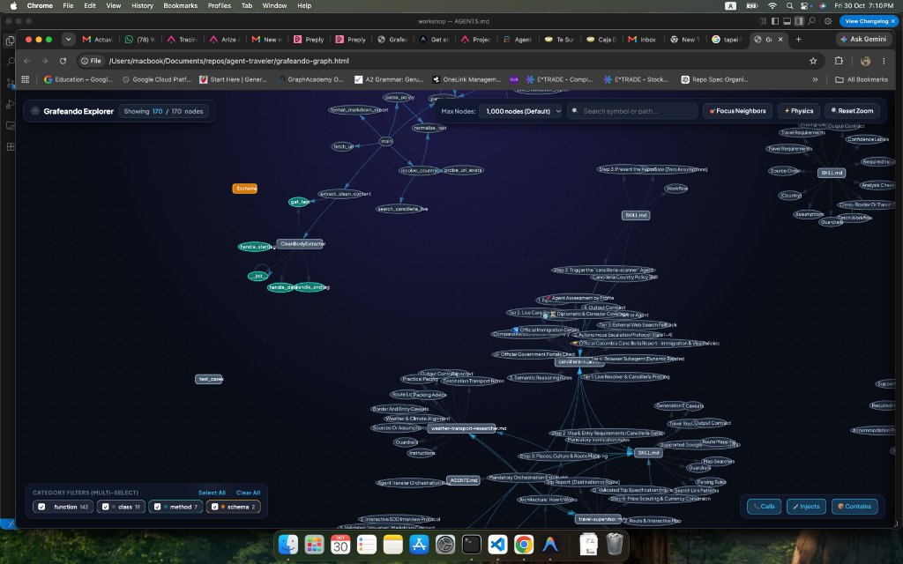

# Agent Traveler

An AI travel planner built for travelers holding ordinary Colombian passports.

Instead of jumping straight into speculative hotel searches, Agent Traveler follows a structured, step-by-step workflow: it interviews you to clarify your travel preferences, checks Colombian visa and border requirements, maps realistic transit routes, and calculates indicative budgets in Colombian Pesos (COP).

It does not book flights or process payments. Its goal is to deliver an accurate, actionable travel dossier you can use to plan your trip safely.

---

## Architecture: How It Works

Agent Traveler uses a primary coordinator that delegates tasks to focused specialist agents and tools:

- **Trip Supervisor ([`.agents/agents/travel-supervisor.md`](.agents/agents/travel-supervisor.md))**: The orchestrator. When you share a trip idea, it checks whether your requirements are complete. If not, it launches an interactive **Spec-Driven Development (SDD)** interview to nail down lodging preferences, target cities, preferred climate, dates, and budget. Once defined, it freezes your requirements into a validated `trip-spec` YAML contract.
- **Visa & Entry Checker ([`.agents/agents/cancilleria-scanner.md`](.agents/agents/cancilleria-scanner.md))**: Verifies travel permissions for Colombian passport holders using official Cancillería guidelines, embassy policies, and layover rules. If a destination is legally unfeasible, it alerts you before planning routes.
- **Route & Sights Planner ([`.agents/agents/destination-researcher.md`](.agents/agents/destination-researcher.md))**: Orders stops logically, highlights local culture and food, and generates clean, clickable Google Maps links.
- **Weather & Local Transport ([`.agents/agents/weather-transport-researcher.md`](.agents/agents/weather-transport-researcher.md))**: Compares destination weather against your preferences, recommends seasonal packing, and explains metro, bus, and reliable taxi options.
- **Price & Live Currency Scout ([`.agents/skills/travel-price-scouting`](.agents/skills/travel-price-scouting/SKILL.md))**: Pulls indicative price ranges for flights and lodging (Booking, Airbnb, Kayak) matching your exact room and price filters, with live USD/EUR to COP exchange rates.

---

## Spec-Driven Development (SDD) Gate

Agent Traveler prevents wasted tokens and hallucinated itineraries by enforcing an explicit validation gate:

1. **Interview**: If your prompt lacks key details (e.g., "I want to visit the US for 2 weeks"), the agent pauses at Step 1 and asks for missing parameters (lodging style, bathroom preference, star rating, nightly price cap, cities, weather, origin airport).
2. **Contract Freeze**: Answers are saved as a structured `trip-spec` defined in [`.agents/specs/trip-spec-schema.md`](.agents/specs/trip-spec-schema.md).
3. **Execution**: Downstream research (visas, routes, flights, pricing) only runs once the spec is valid.

---

## Codebase Architecture & Graph Explorer

Agent Traveler uses [Grafeando](.agents/skills/grafeando/SKILL.md) powered by LadybugDB to map AST entities, dependency relationships, call graphs, and blast radius across agents, skills, and schemas.



To explore or update the graph:

```bash
# Re-index AST entities into LadybugDB
grafeando index .

# Generate interactive standalone HTML graph explorer
grafeando html
```

---

## Setup & Running the Evaluation Suite

We use the Google Antigravity Python SDK (`google-antigravity`) to run automated evaluation test cases against the supervisor's interview gate and guardrails.

### 1. Create a Virtual Environment

```bash
python3 -m venv .venv
source .venv/bin/activate
pip install -r requirements.txt
```

### 2. Configure Credentials

Create a `.env` file in the project root:

```bash
GEMINI_KEY="your_api_key_here"
GEMINI_MODEL="gemini-3.5-flash-lite"
```

The runner supports both `GEMINI_KEY` and `GEMINI_API_KEY`.

### 3. Run the Evals

Run the test cases in `evals/test_cases.json`:

```bash
# Run all test cases live using the model in .env
python -m evals.run_evals

# Run in offline mock mode (no API calls, validates rubric engine)
python -m evals.run_evals --mock

# Run a specific test case without updating test_cases.json
python -m evals.run_evals --test-id tc-001-usa-2-weeks-incomplete-interview --no-update

# Override model or key on the command line
python -m evals.run_evals --model gemini-3.8-flash --api-key YOUR_KEY
```

Every run logs execution history in [`evals/test_cases.json`](evals/test_cases.json) and writes a markdown summary to `evals/reports/report_v<version>.md` (for example, [`evals/reports/report_v1.0.0.md`](evals/reports/report_v1.0.0.md)).

---

## Roadmap

- [x] **Spec-Driven Development (SDD)**: Interactive interview protocol and validated `trip-spec` schema contract ([`.agents/specs/trip-spec-schema.md`](.agents/specs/trip-spec-schema.md)).
- [x] **Antigravity SDK Test Harness**: Automated evaluation runner that verifies the Step 1 interview gate and blocks premature route/pricing actions ([`evals/run_evals.py`](evals/run_evals.py)).
- [ ] **Google ADK Migration**: Explore Google Agent Development Kit (ADK) for deterministic state machines and session checkpointing. 